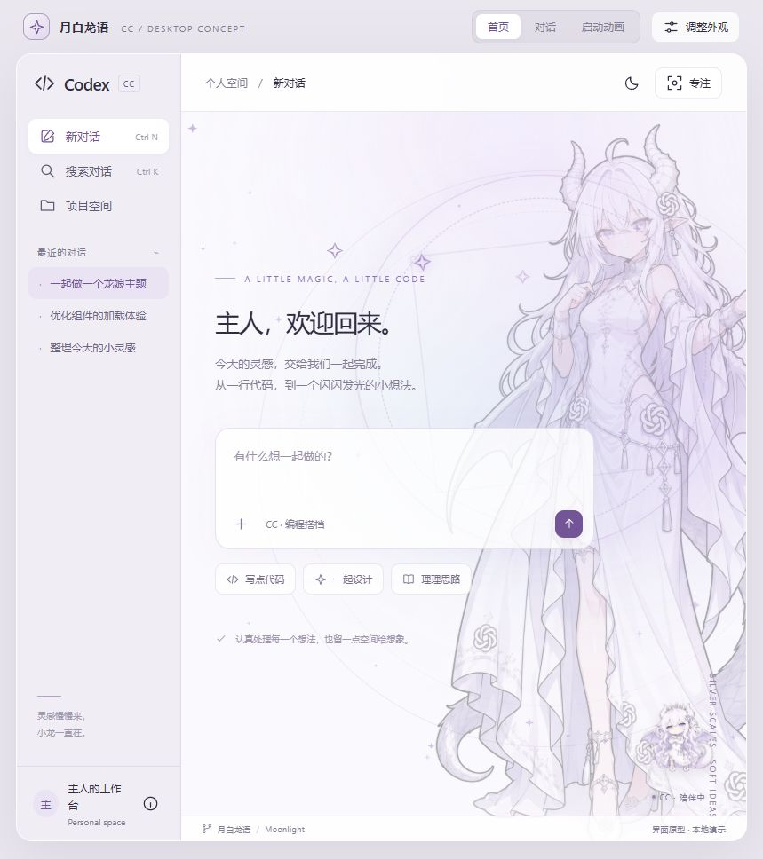

# CCskin · 月白龙语

银白与淡紫配色的 Windows Codex / ChatGPT 桌面主题扩展，包含龙娘立绘、动态伴宠、星辉动效和视频片头。

当前版本 **1.3.0**。已有安装的用户请完整解压更新 ZIP，保存主题窗口的草稿后，从解压目录双击 **`Update.cmd`**；更新会关闭并重开主题实例，保留 profile 与偏好设置。[本版变更](docs/CHANGELOG.md)。

已知限制：用户实测窗口还原/缩小已正常，最大化仍有残余抖动；本版未宣称完全解决。详见 [1.1 验证记录](docs/VALIDATION-v1.1.json)。

通过本机 CDP 在真实客户端中加载主题，保留原生输入框、项目导航和对话内容，不改写官方安装包、`app.asar` 或模型配置。这是独立实现的外置主题扩展，不是 OpenAI 官方插件，也不是可直接导入 Dream Skin 的普通主题 ZIP。



上图是设计演示，不是原生客户端截图。原生版沿用客户端自己的布局。

## 功能

- 首页全身立绘与对话横版背景分别显示；图片边缘以 CSS 蒙版融合底色。
- 月白、暮紫、跟随系统三种配色；输入框与代码区透明度可调。
- 极光、旋转法阵、星尘、鼠标辉光、点击粒子；静谧、轻盈、华丽三档。
- 专注模式隐藏背景和伴宠并暂停氛围动效；支持系统减少动态效果偏好。
- `voira-chatgpt` v2 动画伴宠：待机、悬停挥手、点击跳跃。
- 8 秒启动视频先于客户端显示。每块屏幕播放完整画面，客户端在遮罩后加载；视频结束或跳过后立即回到客户端，慢启动由原生加载界面继续显示。
- 设置保存于主题实例中；原生页面重新加载后，引擎重新加载主题。
- 设置入口位于主内容区左上方，避开侧栏底部的个人账户入口。

伴宠动作来自本地交互，不代表模型实际任务状态；片头不是客户端加载进度条。

## 环境要求

| 项目 | 要求 |
| --- | --- |
| 系统 | Windows x64 |
| 客户端 | 官方 Microsoft Store 包 `OpenAI.Codex` |
| Node.js | 22 或更高版本，`node.exe` 已加入 PATH |
| PowerShell | Windows PowerShell 5.1；入口使用 `RemoteSigned` |
| 已验证客户端版本 | `26.1027.6604.0` |

客户端更新可能改变页面结构，需要重新适配。未验证 macOS、Linux 或所有历史客户端版本。

## 下载与启动

1. 下载仓库 **Code → Download ZIP** 并完整解压，或执行：

   ```powershell
   git clone https://github.com/Youtorin/CCskin.git
   cd CCskin
   ```

2. 双击 `Start.cmd` 启动独立主题窗口。不要直接运行 `engine.cjs`，它需要启动器生成的会话信息。
3. 如需安装并创建桌面快捷方式，运行 `Install.cmd`，然后使用桌面的 **CC 月白龙语**。
4. 点击内容区左上方的 **月白龙语** 调整外观，旁边的 **专注** 可切换专注模式。

安装目录为 `%LOCALAPPDATA%\CCMoonlight\app`。普通安装不会覆盖已有安装或同名快捷方式，也不会自动启动客户端。无需运行上游安装器或 `npx codex-pets`，主题内伴宠素材已包含。

如果桌面快捷方式无反应或安装文件丢失，关闭主题实例后，从完整下载的仓库目录双击 `Repair.cmd`。它补齐安装文件并修复本项目的快捷方式，保留 `profile`；同名但指向其他程序的快捷方式不会覆盖。快捷方式使用可见命令窗口：启动失败时保留报错，恢复结束时显示结果，避免一闪而过。

若下载的 PowerShell 文件被 Windows 的互联网来源标记阻止执行，请先检查代码与来源，再在文件属性中解除相应文件的阻止；无需全局降低执行策略。

### 实例与数据

主题窗口使用独立目录 `%LOCALAPPDATA%\CCMoonlight\profile`，不会复制原窗口的登录凭据。若客户端要求登录，请正常登录。账号服务行为由官方客户端负责。

运行状态为 `%LOCALAPPDATA%\CCMoonlight\session.json`，日志为同目录的 `engine.log`、`engine-error.log`、`lifecycle.log` 和 `watcher-error.log`。这些本机文件不应提交到 Git。重复打开快捷方式时，启动器按独立 profile 查找现有实例，尝试唤回窗口；只有后台进程时向同一 profile 请求窗口，不再把正常的重复启动当作错误。过期 session PID 会重新核对并修正。从官方图标启动的窗口不会自动加载本主题。

### 启动动画与交接

启动遮罩由每块显示器上的独立 WPF 窗口组成，所有窗口共用一个播放器，同步显示完整视频，不再把双屏当成一张横跨桌面的画布。窗口按显示器物理像素定位；不同缩放比例和负坐标布局的实机覆盖仍见验证记录。

视频自然结束、按 `Escape`、点击「跳过动画」或关闭任一遮罩窗口，都会立即收起所有遮罩。主题就绪信号仍写入启动记录，但不再阻止片头退出；客户端加载较慢时会继续显示原生加载界面。播放失败或播放器超过 15 秒没有完成也会释放遮罩，遮罩无法打开不会阻止客户端启动。

调试接口最多等待 60 秒，短暂连接失败会自动重试；首次进程过早退出时自动再启动一次。页面视频重播素材在主题安装后补充，避免把完整视频传输放在首次显示的关键路径上。

启动动画偏好及系统减少动态效果偏好由运行中的主题引擎同步到本机 `launch-preferences.json`，下次启动生效；首次启动默认播放。手动使用 `Start-Moonlight.ps1 -NoIntro` 可跳过。设置面板中的视频重播仍可使用。重复打开运行中的实例不播放动画。

已验证本机双屏窗口的实际边界、视频自然结束后的关闭耗时、独立空白 profile 的真实启停、启动器故障注入，以及当前界面的侧栏滚动与账户菜单。登录状态下完整冷启动、混合 DPI 和多种显示器排列仍需进一步实机覆盖；详见 `docs/VALIDATION-v1.3.json`。

### 恢复、更新与卸载

- **暂停主题**临时恢复原生外观，**恢复月白**重新启用。暂停不会关闭调试端口。
- **退出行为**：关闭全部主题窗口或从托盘退出后，生命周期监视器自动回收该实例的残留进程和主题引擎；最小化窗口保留实例。刚关闭后再次启动会先唤回原窗口，必要时恢复无窗口的失效实例。
- **完整关闭**：保存未发送草稿后运行 `Restore.cmd`，或桌面的 **CC 月白龙语 - 恢复**，关闭主题实例并释放调试端口。原先从官方入口启动的窗口不受影响。
- **更新**：关闭主题实例，备份后替换安装目录中的代码和素材，保留独立的 `profile` 目录。
- **卸载**：关闭主题实例后删除安装目录与两个桌面快捷方式。删除 `profile` 会丢失该实例的本地状态，可选择保留。

可选的 `Install-Pet.ps1` 将伴宠复制到当前用户的原生宠物目录；已有同名目录时不覆盖。运行后需在客户端自行选择。主题伴宠已默认提供，不必同时启用两套宠物。

## 演示与视频

- 浏览器打开 [`demo/index.html`](demo/index.html)，体验首页、对话、设置与片头；需保留仓库的完整相对目录结构。
- 演示使用预设对话，不连接模型，也不修改客户端。
- 演示伴宠使用 CrossPet 静态素材和 CSS 动画；原生主题使用 StephenQiu 的 `voira-chatgpt` 动画图集，二者不同。
- [`assets/startup.mp4`](assets/startup.mp4) 是上游原视频：H.264、2560 × 1440、60 fps、8 秒、无音轨，可查看或下载。

## 目录与开发

```text
Start.cmd / Start-Moonlight.ps1       启动或复用主题实例与后台引擎
Splash-Moonlight.ps1                 多屏同步视频遮罩
Watch-Moonlight.ps1                  主题窗口退出与进程树回收
Install.cmd / Install-Moonlight.ps1   安装及创建快捷方式
Restore.cmd / Restore-Moonlight.ps1   恢复并关闭主题实例
Install-Pet.ps1                      可选的原生宠物安装
engine.cjs                           素材加载与注入生命周期
lib/cdp.cjs                          本机 CDP 连接与校验
runtime/                            主题样式、设置、动效和交互
assets/                             图片、动画图集与启动视频
demo/                               HTML 设计原型及专用素材
docs/                               上游说明、致谢和演示截图
tests/                              无客户端依赖的端点校验
scripts/                            静态检查与校验和生成
VALIDATION.json                     已完成的原生客户端验证记录
THIRD-PARTY.md                       素材来源及许可状态
LICENSE / licenses/                 原创代码许可及第三方许可副本
```

运行时只依赖 Node.js 内置能力，无需 `npm install`。修改后执行：

```powershell
node scripts/checksums.cjs
node scripts/check.cjs
node tests/endpoints.cjs
node tests/startup.cjs
powershell.exe -NoProfile -ExecutionPolicy RemoteSigned -File tests/launcher.ps1
powershell.exe -NoProfile -ExecutionPolicy RemoteSigned -File tests/lifecycle.ps1
```

可选的真实环境检查：`tests/splash.ps1` 会播放一次全屏片头；`tests/smoke.ps1` 会启动并关闭独立空白 profile；`node tests/sidebar.cjs <session.json 的绝对路径>` 检查已运行主题的侧栏滚动与点击命中。测试产生的空白 profile 和日志放在 `work/`。

PowerShell 入口仍应在 Windows 上进行语法和实际启动/恢复验证。`VALIDATION.json` 是既有版本的测试记录；静态命令不会重跑视频等交互验证，也不代表已覆盖所有设置页、弹窗和终端布局。

## 接入边界

调试端口仅监听 `127.0.0.1`。启动器核对官方进程与独立 profile，引擎绑定浏览器会话身份，端口复用时不自动接管新会话。CDP 无内置认证，同机进程可能访问该实例；不要将端口暴露到网络。

主题引擎不采集聊天正文或上传文件，不修改 API Key、模型或代理。主题媒体来自本地文件，无远程字体、脚本或主题服务器依赖；官方客户端本身仍正常联网。

## 素材、上游与致谢

感谢 **ZipZipPipe** 的角色设计、**GenderSwapAI** 的资料整理、**StephenQiu** 的动画伴宠、**CrossPet / lokicorvus** 的演示素材、**mytjxs** 的启动动画，以及 **Fei-Away** 和 **EmiyaKatuz** 的 Dream Skin 项目提供主题与接入思路参考。

- [素材来源与版权说明](THIRD-PARTY.md)：具体文件、作者、来源、修改情况与许可状态。
- [上游项目关系与致谢](docs/UPSTREAM.md)：区分设计参考、媒体来源与代码实现。

## 许可证

本项目原创代码及原创文字文档采用 **[MIT License](LICENSE)**，与 Dream Skin 参考仓库的代码许可一致。MIT 允许使用、修改、再分发及商业使用，分发时须保留版权声明与许可全文。

第三方素材及其改编不包含在上述 MIT 授权中，分别沿用各自来源的许可；这不是可任选 MIT 或素材协议的双重许可。

| 内容 | 适用许可 |
| --- | --- |
| 本项目原创主题引擎、脚本、样式、交互、测试及文字文档 | [MIT](LICENSE) |
| `demo/assets/crosspet-proud.webp` 及基于该素材的美术改编 | **CC BY-NC-SA 4.0**：保留署名、非商业性使用、相同方式共享；[许可全文](licenses/CC-BY-NC-SA-4.0.txt) |
| 首页立绘、横版背景、`voira-chatgpt` 图集、启动视频及其海报 | 未确认明确的再分发许可，保留原权利人的权利；详见 [文件清单](THIRD-PARTY.md) |
| 包含第三方画面的演示截图 | 其中各项素材及其改编分别按来源处理，不由代码的 MIT 许可覆盖 |

CC BY-NC-SA 4.0 含非商业限制，不属于 OSI 定义的开源软件许可证。本项目采用“代码 MIT 开源、素材分别授权”的方式，不能将包含全部素材的下载包视为全部 MIT 或可自由商用。对许可未确认的素材，本仓库不授予额外使用权；再次分发前需取得相应授权，或替换、移除这些素材。

来源、署名、修改记录及核对依据见 [THIRD-PARTY.md](THIRD-PARTY.md) 和 [上游说明](docs/UPSTREAM.md)。本项目不代表 OpenAI、ChatGPT 或 Codex 官方发布或认可。
